# Shos.BezierSamples

マウスで指定した**すべての通過点を滑らかに通る曲線 (3 次スプライン曲線)** を、3 次ベジエ曲線の列として描くサンプル集です。
各プロジェクトには、通過点の列をベジエ曲線に変換する関数として、**3 次スプライン曲線**と **Catmull-Rom スプライン**の 2 種類があります。サンプルアプリケーションは、どれも 3 次スプライン曲線で描きます。
同じアルゴリズムを Win32 (C++)・Windows Forms・WPF・HTML/JavaScript (Canvas と SVG) で書き分けているので、API ごとの違いを見比べられます。
WPF 版を発展させた簡易 CAD ライブラリ **WpfCad2Lib** も含まれています。

> 教材として、プロジェクトごとに独立して読めるようにしています。そのため、曲線の変換のコードや .NET / .NET Framework 版の実装は、意図的にプロジェクトごとに重複させています。

## 目次

- [Shos.BezierSamples](#shosbeziersamples)
  - [目次](#目次)
  - [プロジェクト構成](#プロジェクト構成)
  - [動作環境とビルド](#動作環境とビルド)
    - [HTML/JavaScript 版の実行とテスト](#htmljavascript-版の実行とテスト)
  - [サンプルの操作方法](#サンプルの操作方法)
  - [通過点を通る曲線を作るしくみ](#通過点を通る曲線を作るしくみ)
    - [1 区間の制御点](#1-区間の制御点)
    - [接線を求める連立方程式](#接線を求める連立方程式)
    - [点列全体](#点列全体)
    - [閉じた曲線](#閉じた曲線)
    - [点の間引きとドラッグ中の描画](#点の間引きとドラッグ中の描画)
    - [Catmull-Rom スプラインとの比較](#catmull-rom-スプラインとの比較)
    - [プロジェクトごとの関数](#プロジェクトごとの関数)
  - [HTML/JavaScript 版](#htmljavascript-版)
    - [即時モード (Canvas) と保持モード (SVG)](#即時モード-canvas-と保持モード-svg)
    - [入力 (Pointer Events)](#入力-pointer-events)
    - [座標・高 DPI・リサイズ](#座標高-dpiリサイズ)
    - [スクリプトの構成とテスト](#スクリプトの構成とテスト)
  - [WpfCad2Lib の使い方](#wpfcad2lib-の使い方)
  - [WpfCad2Lib のクラス図](#wpfcad2lib-のクラス図)
    - [MVC の構成](#mvc-の構成)
    - [作図コマンド](#作図コマンド)
    - [図形](#図形)
    - [ユーティリティ (幾何計算・ベジエ変換)](#ユーティリティ-幾何計算ベジエ変換)
    - [ユーティリティ (描画・共通)](#ユーティリティ-描画共通)
  - [.NET 版の入力・表示・履歴の仕様](#net-版の入力表示履歴の仕様)
  - [既知の制限](#既知の制限)
  - [ライセンス](#ライセンス)

## プロジェクト構成

| プロジェクト | 種類 | ターゲット | 内容 |
|---|---|---|---|
| `BezierWin32` | C++ / Win32 | PlatformToolset v145, C++20 | クリックした点を通る曲線を描く最小のサンプル |
| `BezierWinForm` | C# / Windows Forms | `net10.0-windows10.0.26100.0` | ドラッグした軌跡を通る曲線を描く。Model / View / Controller をデザイナーで配置するコンポーネントとして実装 |
| `BezierWinForm.NETFramework` | C# / Windows Forms | .NET Framework 4.8 | `BezierWinForm` の .NET Framework 版 |
| `BezierWpf` | C# / WPF | `net10.0-windows10.0.26100.0` | 線分・矩形・曲線をメニューで切り替えて描く、コマンド方式のサンプル |
| `BezierWpf.NETFramework` | C# / WPF | .NET Framework 4.8 | `BezierWpf` の .NET Framework 版 |
| `WpfCad2Lib.Core` | C# クラスライブラリ | `net10.0` | UI に依存しない共通部品 (`Subject` など) |
| `WpfCad2Lib.Wpf` | C# / WPF クラスライブラリ | `net10.0-windows10.0.26100.0` | 簡易 CAD ライブラリ。図形・選択・ズーム / パン・袋文字 |
| `WpfCad2Lib.TestApp` | C# / WPF アプリ | `net10.0-windows10.0.26100.0` | WpfCad2Lib の動作確認アプリ |
| `BezierSamples.Tests` | C# / xUnit | `net10.0-windows10.0.26100.0` | 曲線の変換・表示変換・入力・選択・履歴の単体テスト (WpfCad2Lib・BezierWpf・BezierWinForm) |
| `BezierCanvas` | HTML / JavaScript | ブラウザ (ES2020) | `BezierWpf` と同じ機能を Canvas 2D (即時モード) で描く |
| `BezierSvg` | HTML / JavaScript | ブラウザ (ES2020) | `BezierWpf` と同じ機能を SVG (保持モード) で描く |
| `BezierHtml.Tests` | JavaScript / `node:test` | Node 22 以上 | HTML/JavaScript 版の単体テスト (曲線の変換・入力・コマンド・描画) |

HTML/JavaScript 版の 3 つは .sln に含めていません (ビルドの対象が無いため)。

```text
Shos.BezierSamples.sln
├─ BezierWin32/                  … Win32 (C++)
├─ BezierWinForm/                … Windows Forms (.NET 10)
├─ BezierWinForm.NETFramework/   … Windows Forms (.NET Framework 4.8)
├─ BezierWpf/                    … WPF (.NET 10)
├─ BezierWpf.NETFramework/       … WPF (.NET Framework 4.8)
├─ WpfCad2Lib.Core/              … 共通ライブラリ
├─ WpfCad2Lib.Wpf/               … 簡易 CAD ライブラリ
│   ├─ Core/                     … MVC・コマンド・図形の基底・ズーム / パン
│   ├─ Commands/                 … 作図コマンド
│   ├─ Figures/                  … 図形
│   └─ Utility/                  … 曲線の変換・幾何計算・袋文字など
├─ WpfCad2Lib.TestApp/           … 動作確認アプリ
├─ BezierSamples.Tests/          … 単体テスト
├─ BezierCanvas/                 … HTML + Canvas (.sln には含まない)
├─ BezierSvg/                    … HTML + SVG (.sln には含まない)
├─ BezierHtml.Tests/             … HTML/JavaScript 版の単体テスト (.sln には含まない)
├─ docs/images/                  … README の図
├─ Plans/                        … 変更の計画書
└─ Reviews/                      … リポジトリのレビュー結果
```

## 動作環境とビルド

C++ と .NET のプロジェクトは Windows 専用です。HTML/JavaScript 版は、[下記](#htmljavascript-版の実行とテスト)のとおりブラウザだけで動きます。

- Windows 10 / 11
- Visual Studio 2026 (PlatformToolset v145)
  - ワークロード「.NET デスクトップ開発」
  - ワークロード「C++ によるデスクトップ開発」 (`BezierWin32` をビルドする場合)
- .NET 10 SDK
- Windows SDK 10.0.26100
- .NET Framework 4.8 Developer Pack (`*.NETFramework` をビルドする場合)

Visual Studio で `Shos.BezierSamples.sln` を開き、スタートアップ プロジェクトを選んで実行します。
コマンドラインの場合は次のとおりです。

```powershell
# ソリューション全体 (C++ と .NET Framework を含む)。Developer PowerShell で実行する
msbuild Shos.BezierSamples.sln -restore

# .NET 10 版は、プロジェクトごとに dotnet コマンドでビルド・実行できる
dotnet run --project BezierWpf/BezierWpf.csproj
dotnet run --project WpfCad2Lib.TestApp/WpfCad2Lib.TestApp.csproj

# 単体テスト
dotnet test BezierSamples.Tests/BezierSamples.Tests.csproj
```

### HTML/JavaScript 版の実行とテスト

- **実行:** ビルドは不要です。`BezierCanvas/index.html` または `BezierSvg/index.html` をブラウザで直接開きます (`file://` のままで動きます。ローカル サーバーは要りません)。最新の Microsoft Edge / Google Chrome / Mozilla Firefox を想定しています。
- **テスト:** Node 22 以上で、リポジトリのルートから次を実行します。npm パッケージは使いません。Node はテストのためだけに使い、ブラウザでの実行には要りません。

```text
node --test "BezierHtml.Tests/*.test.js"
```

glob は引用符で囲み、シェルではなく Node に展開させます (PowerShell・bash 共通)。

## サンプルの操作方法

| サンプル | 操作 |
|---|---|
| `BezierWin32` | 左クリックで通過点を追加します。右クリックで全消去します。 |
| `BezierWinForm` | 左ボタンでドラッグすると、その軌跡を通る曲線になります。 |
| `BezierWpf` | 「図形」メニューで線分・矩形・曲線を選んでからドラッグします。 |
| `BezierCanvas` / `BezierSvg` | ツールバーで線分・矩形・曲線を選んでからドラッグします (選んでいるボタンが強調されます)。起動直後はどれも選ばれておらず、ドラッグしても何も描きません。タッチ・ペンでも描けます。 |
| `WpfCad2Lib.TestApp` | 下の表を参照してください。 |

`WpfCad2Lib.TestApp` の操作は次のとおりです。

| 操作 | 内容 |
|---|---|
| 「図形」→「選択」 | クリックした位置の近くにある図形を選びます。何もない所をクリックすると選択を解除します。 |
| 「図形」→「線分」「矩形」「楕円」「曲線」「矢印」 | ドラッグで作図します。 |
| 「図形」→「文字列」 | クリックした位置に袋文字を置きます。 |
| 「設定」→「サイズ」「色」 | これから描く図形の線の太さ・文字サイズ・色を変えます。 |
| 「画面」→「ホーム」 | ズームとパンを初期状態に戻します。 |
| マウスホイール | 奥に回すと拡大、手前に回すと縮小します (等倍より小さくはなりません)。 |
| 矢印キー | 表示をパンします。先に作図領域をクリックしてフォーカスを移してください。 |

## 通過点を通る曲線を作るしくみ

各プロジェクトには、3 次スプライン曲線と Catmull-Rom スプラインの変換関数があります。
サンプルアプリケーション (Win32 版・WinForms 版・WPF 版・WpfCad2Lib・HTML/JavaScript 版) は、どれも通過点の列から**自然 3 次スプライン曲線** (すべての点を通り、つなぎ目で曲率まで連続する曲線) を求め、3 次ベジエ曲線の列として描きます。
この章では、まず 3 次スプライン曲線を説明し、最後に [Catmull-Rom スプラインとの比較](#catmull-rom-スプラインとの比較) で 2 つの違いを説明します。

### 1 区間の制御点

各通過点 P(i) での曲線の接線 (向きと速さ) を m(i) とします。
すると、隣り合う通過点の区間 P(i) → P(i+1) は、次の制御点を持つ 3 次ベジエ曲線になります。

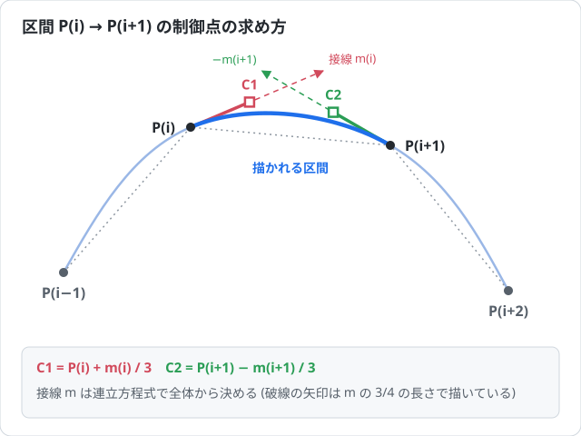

```text
C1 = P(i)   + m(i)   / 3
C2 = P(i+1) − m(i+1) / 3
```

3 次ベジエ曲線の接線は、始点では「始点から制御点 C1 へのベクトルの 3 倍」、終点では「制御点 C2 から終点へのベクトルの 3 倍」になります。

```text
B′(0) = 3·(C1 − P(i))
B′(1) = 3·(P(i+1) − C2)
```

そのため、始点から接線の 1/3 だけ進んだ位置に C1、終点から接線の 1/3 だけ戻った位置に C2 を置けば、それぞれの通過点で接線 m を持つ曲線になります (3 次エルミート曲線をベジエで表したもの)。
隣の区間とは同じ接線を共有するので、通過点で向きがそろいます。

### 接線を求める連立方程式

接線 m は、つなぎ目で**曲がり具合 (2 階微分) もそろう**ように決めます。
各区間をパラメーター t (0〜1、どの区間も同じ幅) の 3 次式とすると、この条件から、内側の通過点ごとに次の式が成り立ちます。

```text
m(i−1) + 4·m(i) + m(i+1) = 3·(P(i+1) − P(i−1))      (i = 1 … n−2)
```

未知数 m が n 個に対して式が n − 2 個なので、両端に条件を足します。
**自然スプライン**では、端点で曲がり具合を 0 にします。

```text
2·m(0)   + m(1)     = 3·(P(1)   − P(0))
m(n−2)   + 2·m(n−1) = 3·(P(n−1) − P(n−2))
```

まとめると、係数が対角とその左右だけにある**三重対角**の連立方程式になります。

```text
| 2 1           |   | m(0)   |   | 3·(P(1) − P(0))     |
| 1 4 1         |   | m(1)   |   | 3·(P(2) − P(0))     |
|   1 4 1       | · | m(2)   | = | 3·(P(3) − P(1))     |
|     …  …  …   |   |  …     |   |  …                  |
|         1 2   |   | m(n−1) |   | 3·(P(n−1) − P(n−2)) |
```

- どの行も対角の係数 (4 や 2) が左右の係数の和より大きい (対角優位) ので、**トーマス法** (前進消去と後退代入) で、ピボット選択なしに O(n) で安定して解けます。
- x 座標と y 座標は同じ係数行列なので、右辺だけを替えて 2 回解きます。

WpfCad2Lib の実装 (`GeoExtensions` の `SolveTridiagonal`) は次のとおりです。

```csharp
// 三重対角の連立方程式 lower[i]·x(i−1) + diagonal[i]·x(i) + upper[i]·x(i+1) = right[i] を、
// トーマス法 (前進消去と後退代入) で解く。lower[0] と upper[n−1] は使わない
static double[] SolveTridiagonal(double[] lower, double[] diagonal, double[] upper, double[] right)
{
    var count        = diagonal.Length;
    var reducedUpper = new double[count];   // 前進消去後の upper (対角を 1 に正規化したもの)
    var reducedRight = new double[count];   // 前進消去後の right
    // 前進消去: 各行から 1 つ上の行の lower 倍を引き、左側の係数を消していく
    for (var index = 0; index < count; index++) {
        var previousUpper = index == 0 ? 0.0 : reducedUpper[index - 1];
        var previousRight = index == 0 ? 0.0 : reducedRight[index - 1];
        var denominator   = diagonal[index] - lower[index] * previousUpper;
        reducedUpper[index] = upper[index] / denominator;
        reducedRight[index] = (right[index] - lower[index] * previousRight) / denominator;
    }
    // 後退代入: 最後の行から順に、1 つ下の行の解を使って求める
    var x = new double[count];
    x[count - 1] = reducedRight[count - 1];
    for (var index = count - 2; index >= 0; index--)
        x[index] = reducedRight[index] - reducedUpper[index] * x[index + 1];
    return x;
}
```

### 点列全体

n 個の通過点 P0〜P(n−1) から、最初と最後の区間も含めて n − 1 個のベジエ区間ができます。
変換処理 (`ToSplineBezier`) は、`[P0, C1, C2, P1, C1, C2, P2, …, P(n−1)]` の 1 + 3(n − 1) 点を返します。
これは、各 API のベジエ描画関数が受け取る形式そのものです。

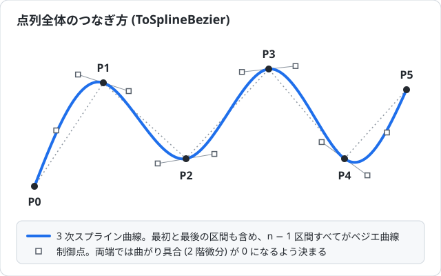

| 通過点の数 | 変換結果を描画した場合 |
|---|---|
| 0〜1 | 何も描かない |
| 2 | 直線 (m(0) = m(1) = P(1) − P(0) になり、ベジエ曲線も直線になる) |
| 3 以上 | n − 1 区間の曲線 |

これは変換結果の説明で、サンプルの作図 UI には別の表示条件があります。`BezierWpf` と HTML/JavaScript 版は通過点が 3 個以上のときだけ曲線を表示し、2 個以下で確定しても何も表示しません。WpfCad2Lib の `CurveFigure` も 3 個以上を有効とし、2 個以下で確定した図形は破棄します。

### 閉じた曲線

`ToClosedSplineBezier` (WinForms の `DrawBezierPolygon`、WPF の `BezierPolygonPathGeometry`) は、最後の点から最初の点へ戻って 1 周する曲線を作ります。

- 最後の点の次を最初の点とみなし、**すべての**通過点で `m(i−1) + 4·m(i) + m(i+1) = 3·(P(i+1) − P(i−1))` (添字は n を法とする) を解きます。
- 両端の条件は要りませんが、係数行列の左下と右上の角にも 1 が入ります (巡回三重対角)。
- これを **Sherman-Morrison の公式**で、角を除いた三重対角の連立方程式 2 つに分けて、トーマス法で解きます。
- 最初の点でも曲率まで連続した、継ぎ目の無い曲線になります。

### 点の間引きとドラッグ中の描画

- **点の間引き:** ドラッグで点を集めるサンプルでは、マウスの細かい揺れで曲線が波打たないよう、直前の点から一定距離以上動いたときだけ点を追加します。距離は `BezierWinForm` が 10、`BezierWpf` と HTML/JavaScript 版が 16 (HTML/JavaScript 版は CSS ピクセル)、WpfCad2Lib の `CurveFigure` が 8 です。ドラッグを終えた位置は、距離にかかわらず必ず曲線の終点になります。
- **ドラッグ中の描画 (`CurveFigure`):**
  - 3 次スプラインでは、点を 1 つ足すと全区間の接線が少しずつ変わります。ドラッグ中に毎回全体を作り直すと、長い曲線では全体で O(n²) の計算になります。
  - ただし、1 点の変化の影響は 1 区間離れるごとに約 0.27 倍 (2 − √3) に減ります。
  - そこでドラッグ中は、末尾の 6 区間の接線だけを解き直して差し替え、それより前の接線は固定します (影響は 0.27⁶ ≈ 0.04%)。
  - ドラッグを終えたときに、全体を正確に作り直します。
  - ほかのサンプルは点が少ないか、描くたびに全体を計算しても十分に速いので、毎回全体を作り直しています。

### Catmull-Rom スプラインとの比較

各プロジェクトには、3 次スプライン曲線の関数と並んで、**Catmull-Rom スプライン**でベジエ曲線用の点列を作る関数 (`ToBezierPolyline` / `ToBezierPolygon` など) があります。
サンプルアプリケーションの描画には使っていませんが、3 次スプライン曲線と比べられるよう、同じ形式の点列を返します。

違うのは**接線 m の求め方だけ**です。Catmull-Rom は、両隣の点だけで `m(i) = (P(i+1) − P(i−1)) / 2` と決めます。
制御点は `P(i+1) ± (P(i+2) − P(i)) / 6` になります (1/6 = 接線の 1/2 × 制御点の位置 1/3)。

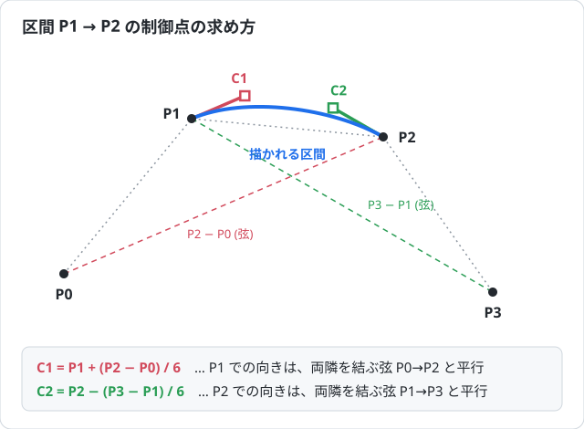

3 次スプラインの連立方程式で、両隣の接線が自分と同じ (m(i−1) = m(i+1) = m(i)) と仮定すると、`6·m(i) = 3·(P(i+1) − P(i−1))` となります。
これは Catmull-Rom の接線そのものです。つまり Catmull-Rom は、3 次スプラインの連立方程式を、その場の情報だけで近似したものといえます。

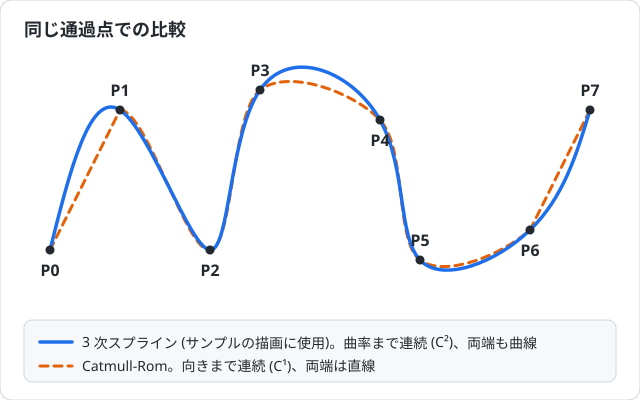

| | 3 次スプライン | Catmull-Rom |
|---|---|---|
| 点を通るか | 通る | 通る |
| 連続性 | C² (2 階微分まで) | 内側の曲線区間どうしは C¹ (1 階微分まで)。両端を直線で補うと、その接続は一般に C⁰ (位置だけ) |
| 最初と最後の区間 | 曲線 (自然スプラインの条件) | この実装では変換の対象外。下図では呼び出し側で直線を補う |
| 1 点を動かしたときの影響 | 全区間 (1 区間ごとに約 0.27 倍に減る) | 近くの 4 区間だけ |
| 計算 | 三重対角の連立方程式 (O(n)) | 区間ごとに個別に計算 |
| 最適性 | 曲がりの総量 ∫‖C″‖² が最小 | 特に無い |

`ToBezierPolyline` は、通過点が 4 個以上のとき、前後の点がそろう内側の n − 3 区間だけを返します (4 個未満なら通過点をそのまま返します)。下図は、最初の区間 (P0 → P1) と最後の区間を呼び出し側で直線にして、点列全体をつないだものです。この直線と曲線の接続では一般に接線方向が一致せず、角ができます。両端を直線にするのはここでの補完方法で、Catmull-Rom 自体の必須条件ではありません。

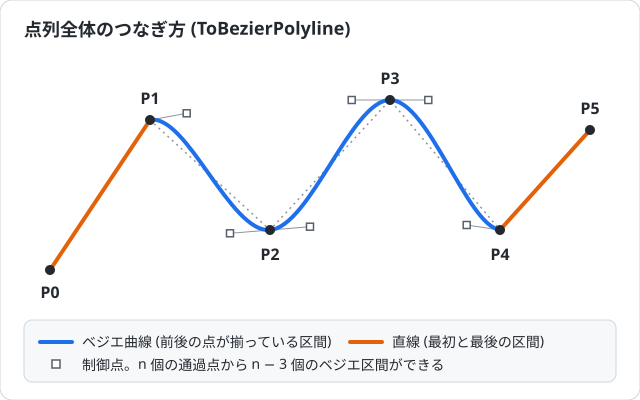

### プロジェクトごとの関数

| プロジェクト | 3 次スプライン (サンプルで使用) | Catmull-Rom | 描画 |
|---|---|---|---|
| `BezierWin32` | `Win32Graphics::ToSplineTangents` / `ToSplineBezier` | `Win32Graphics::ToBezierPolyline` | `::MoveToEx` + `::PolyBezierTo` (2 点のときは `::Polyline`) |
| `BezierWinForm` | `GeometryExtensions.ToSplineTangents` / `ToSplineBezier` / `ToClosedSplineBezier` | `GeometryExtensions.ToBezierPolyline` / `ToBezierPolygon`、`Geometry.ToBezier` | `Graphics.DrawBeziers` (2 点のときは `Graphics.DrawLine`) |
| `BezierWpf` | `GeometryExtensions.ToSplineTangents` / `ToSplineBezier` / `ToClosedSplineBezier` | `GeometryExtensions.ToBezierPolyline` / `ToBezierPolygon`、`Geo.ToBezier` | `PathGeometry` + `BezierSegment` |
| `WpfCad2Lib.Wpf` | `GeoExtensions.ToSplineTangents` / `ToSplineBezier` / `ToClosedSplineBezier` | `GeoExtensions.ToBezierPolyline` / `ToBezierPolygon`、`Geo.ToBezier` | `GeoHelper.BezierPathGeometry` (`PathGeometry`)、`CurveFigure` (差分更新) |
| `BezierCanvas` | `Geometry.toSplineTangents` / `toSplineBezier` / `toClosedSplineBezier` | `Geometry.toBezierPolyline` / `toBezierPolygon` / `toBezier` | `GraphicHelper.addBezierPath` (`moveTo` + `bezierCurveTo`) |
| `BezierSvg` | `Geometry.toSplineTangents` / `toSplineBezier` / `toClosedSplineBezier` | `Geometry.toBezierPolyline` / `toBezierPolygon` / `toBezier` | `GraphicHelper.toPathData` (`<path>` の `d` 属性 `M … C …`) |

- **閉じた曲線:** `BezierWin32` には、閉じた曲線の関数 (3 次スプラインの `ToClosedSplineBezier`、Catmull-Rom の `ToBezierPolygon`) はありません。

- **座標の型:** Win32 版は整数の `POINT` なので、接線は実数のベクトル (`Vector2`) で求め、制御点を最後に整数へ丸めます。WinForms 版は `float` の `PointF` なので、連立方程式の途中の計算を `double` で行います。
- **単体テスト:** `BezierSamples.Tests` は、.NET 10 版の 3 つの実装 (WpfCad2Lib・BezierWpf・BezierWinForm) の 3 次スプライン曲線の関数について、次の点を確かめています (Catmull-Rom の関数はテストの対象外です)。
  - すべての点を通ること
  - つなぎ目で 1 階微分と 2 階微分が一致すること
  - 両端で 2 階微分が 0 になること
  - 実装どうしで同じ制御点になること
- **.NET の操作・状態の回帰テスト:** `BezierSamples.Tests` では、CAD のゼロ寸法からの復帰・パン／ズーム後のリサイズ・楕円輪郭の選択・削除順序と Update の Undo/Redo、WPF／CAD のドラッグ解放時の閾値判定・コマンド変更、WinForms のキャプチャー喪失も検証します。UI 要素を使う処理は STA で実行します。実マウス操作と .NET Framework ランタイム上の実行はこのテストの対象外です。
- **HTML/JavaScript 版の単体テスト:** `BezierHtml.Tests` は、2 つの版の `geometry.js` について、WPF 系のテストと同じ入力生成式・許容誤差 (距離 1e-9) で同じ性質を確かめます。WinForms 版のテストは、`float` の丸めを考慮して許容誤差を 1e-3 にしています。閉じた曲線と Catmull-Rom 版の関数、0 点・1 点の戻り値、2 つの版の結果の一致も確かめます。

## HTML/JavaScript 版

`BezierCanvas` と `BezierSvg` は、`BezierWpf` (.NET 10 版) と同じ機能・同じ構造をブラウザで動く JavaScript で書いたものです。
`MouseEventConverter` (クリック/ドラッグへの変換) → `Controller` → `Command` (`EditCommand` / `LineCommand` / `RectangleCommand` / `BezierCommand`、`AddCommand` の Template Method) という MVC + Command パターンも、クラス名・メソッド名 (JavaScript の慣習に合わせて camelCase) もそろえています。
2 つの版の違いは**描画の方式だけ**です。

### 即時モード (Canvas) と保持モード (SVG)

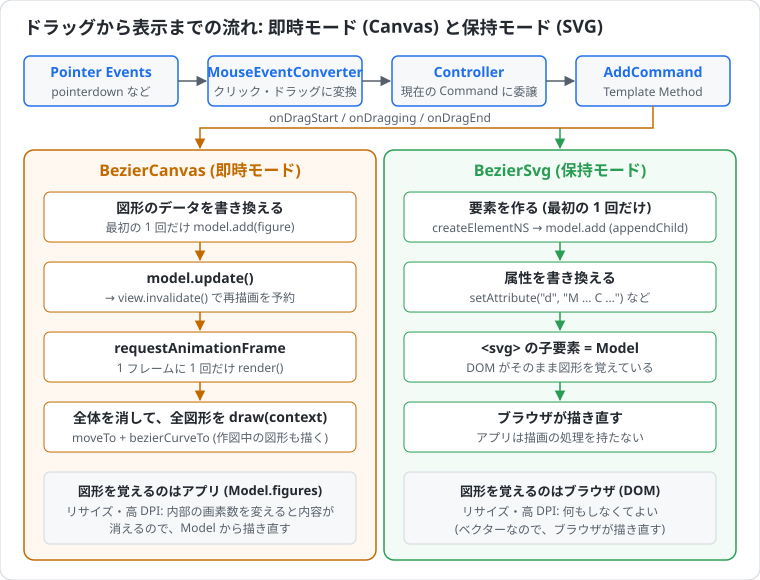

| | BezierCanvas (即時モード) | BezierSvg (保持モード) |
|---|---|---|
| 図形を持つもの | アプリの Model (`model.figures`。普通のオブジェクトの配列) | DOM (`<svg>` の子要素)。DOM がそのまま Model になる (WPF の `UIElementCollection` と同じ) |
| 図形を描く処理 | 図形ごとの `draw(context)` をアプリが書く | ブラウザが描く。アプリは要素と属性を作るだけ |
| 形を変えたとき | データを書き換え、`model.update()` → `view.invalidate()` → 次のフレームで全体を消して描き直す | 属性を書き換えるだけ。描き直しはブラウザが行う |
| 作図中の図形 | 最初の `onDragging` で Model に追加し、毎回の再描画で確定済みの図形と一緒に描く | 最初の `onDragging` で `<svg>` に追加し、属性を書き換える |
| 高 DPI | 内部の画素数を `devicePixelRatio` に合わせ、`setTransform` で CSS ピクセルに合わせる | ベクターなので不要 |
| リサイズ | 内部の画素数を変えると内容が消えるので、Model から描き直す | 何もしなくてよい |
| 曲線の形式 | `moveTo` + `bezierCurveTo` の呼び出し | `d` 属性の文字列 `M … C …` |
| 向いている用途 | 図形が非常に多い描画や、毎フレーム全体が変わる描画 | 図形ごとの選択・イベント・スタイルの変更 (DevTools で要素を確かめられる) |
| 近い版 | WinForms 版 (`OnPaint`) | WPF 版 (`Shape` を `Canvas` に追加) |

- どちらの版も、作図中の図形を Model に追加するのは最初の `onDragging` の 1 か所だけなので、確定時に二重に登録されることはありません。
- 通過点が 2 個以下で確定した曲線は、WPF 版と同じく Model (DOM) に残りますが、何も表示しません。
- **線の見え方:** WPF の `Rectangle` は線を図形の内側に描きます (幅・高さの中に線が収まる)。Canvas 2D の `rect` と SVG の `<rect>` は線を輪郭の中心に描くので、線の太さ 3 の半分 (1.5 CSS ピクセル) だけ外にはみ出します。HTML 版は標準の描き方のままにしています。

### 入力 (Pointer Events)

入力には Pointer Events を使い、`MouseEventConverter` で WPF 版と同じクリック/ドラッグに変換します。

| WPF 版 | HTML/JavaScript 版 |
|---|---|
| `CaptureMouse()` / `ReleaseMouseCapture()` | `setPointerCapture()` / `releasePointerCapture()` |
| `LostMouseCapture` | `lostpointercapture`、`pointercancel` |
| `MouseLeftButtonDown` / `MouseLeftButtonUp` | `pointerdown` / `pointerup` (`button` が 0) |
| `MouseMove` で `e.LeftButton == MouseButtonState.Pressed` を確かめる | `pointermove` で `buttons & 1` を確かめる |

- ドラッグの判定 (押下位置から 10 CSS ピクセル以上) と、判定前の移動位置をためて `dragStart` → `dragging` の順に通知する処理は、WPF 版と同じです。状態遷移の本体 (`onButtonDown` / `onMove` / `onButtonUp` / `onLostCapture`) は DOM に依存しません。
- HTML/JavaScript 版では、解放位置でもドラッグの距離を判定します。移動通知が無い場合や、解放時に初めて 10 CSS ピクセル以上離れた場合も、開始・移動・終了を順に通知して図形を確定します。
- ドラッグ開始時の Command が、終了 (キャンセル・キャプチャー喪失も含む) まで同じ図形を扱います。作図中にツールバーでモードを変更・再選択しても現在の図形は完成まで描き、新しいモードは次のドラッグから使います。ボタンの選択表示はその場で変わります。
- 対象は**主ポインター** (`isPrimary`: マウス・ペン・最初に触れた指) の左ボタンだけです。操作中は、ほかのポインター (2 本目の指など) を無視します。
- ほかのボタンを押したまま左ボタンを押す・離すと、`pointerdown` / `pointerup` ではなく `pointermove` として届きます (コード化されたボタン操作)。そのため、`button` と `buttons` で左ボタンの変化を判定します。
- ブラウザの外で離して `pointerup` を取りこぼした場合も、次に届いた `pointermove` で左ボタンが離れていれば、その位置でドラッグを終えます。

### 座標・高 DPI・リサイズ

- 座標・距離のしきい値 (10 / 16)・線の太さ (3) は、すべて描画領域の左上を原点とする **CSS ピクセル**で扱います。ポインターの位置は `clientX - getBoundingClientRect().left` などで求めます。
- **BezierCanvas:** `<canvas>` の表示サイズは CSS で決め、内部の画素数を「表示サイズ × `devicePixelRatio`」にします。描くたびに `setTransform` で CSS ピクセルを内部の画素に合わせるので、高 DPI でもぼやけず、座標や線の太さは変わりません。表示サイズの変化は `ResizeObserver` で、`devicePixelRatio` だけの変化 (表示倍率の違うモニターへの移動など) は `matchMedia` で知り、Model から描き直します。
- **BezierSvg:** `<svg>` に `viewBox` を付けないので、SVG の座標は CSS ピクセルと一致し、ポインターの位置をそのまま属性に使えます。高 DPI・リサイズのための処理はありません。
- どちらの版も、描画領域を小さくしても図形の座標は変えません。はみ出した部分は見えなくなり、元の大きさに戻すと再び表示されます (WPF の `Canvas` と同じ)。

### スクリプトの構成とテスト

| ファイル | 内容 | BezierWpf |
|---|---|---|
| `index.html` / `style.css` | ツールバーと描画領域 | `MainWindow.xaml` / `View.xaml` |
| `geometry.js` | 曲線の計算。DOM・Canvas・SVG に依存しない | `Geometry.cs` (`Geo` / `GeometryExtensions`) |
| `graphic-helper.js` | 点列 → `bezierCurveTo` / `d` 属性 | `Geometry.cs` (`GraphicHelper`) |
| `mouse-event-converter.js` | Pointer Events → クリック/ドラッグ | `MouseEventConverter.cs` / `IMouseAcceptor.cs` |
| `model.js` | Canvas 版: 図形の配列と変更の通知。SVG 版: `<svg>` 要素を包む | `canvas.Children` |
| `figures.js` (Canvas 版だけ) | `LineFigure` / `RectangleFigure` / `BezierFigure` (`draw(context)` を持つ) | `Line` / `Rectangle` / `Path` |
| `command.js` / `controller.js` | Command と Controller | `Command.cs` / `Controller.cs` |
| `view.js` | Canvas 版: 高 DPI・リサイズ・再描画。SVG 版: 入力の結線だけ | `View.xaml.cs` |
| `main.js` | 結線とツールバー。トップレベルの `model` / `controller` は DevTools のコンソールから参照できる | `MainWindow.xaml.cs` |

- `index.html` を `file://` で直接開けるよう、ES Modules ではなく classic script (`<script src>`) を依存の順に読み込みます。ビルドツール・npm パッケージ・フレームワークは使いません (ES2020 の範囲で書いています)。
- 同じファイルを Node のテストからも読み込めるよう、各ファイルの末尾で、Node から読み込まれたときだけ `module.exports` で公開します。
- 2 つの版の `geometry.js` などは同じ内容ですが、ほかのプロジェクトと同じく、各フォルダーだけで読めるよう共通化していません (内容のずれはテストで検出します)。
- `BezierHtml.Tests` は、計算のほかに、入力の状態遷移 (ドラッグ開始の距離、解放時の閾値判定、キャプチャーの喪失、Pointer Events の振り分け)、コマンド (点の間引き、確定時の置換・追加、二重登録の防止)、Canvas 版の再描画 (偽の Canvas のコンテキストへの描画命令、リサイズと `devicePixelRatio` の変化)、`index.html` のスクリプトの読み込みと作図中のモード変更を確かめます。実際のブラウザでの表示や操作は、テストの対象外です。

## WpfCad2Lib の使い方

`View` (UserControl) をウィンドウに置き、`MVC` で Model・View・Controller を結び付けます。
描画モードは `mvc.Command` に作図コマンドを設定して切り替えます。

```xml
<Window x:Class="MyApp.MainWindow"
        xmlns="http://schemas.microsoft.com/winfx/2006/xaml/presentation"
        xmlns:x="http://schemas.microsoft.com/winfx/2006/xaml"
        xmlns:w="clr-namespace:WpfCad2Lib.Wpf;assembly=WpfCad2Lib.Wpf">
    <w:View x:Name="view" />
</Window>
```

```csharp
using System.Windows;
using System.Windows.Media;
using WpfCad2Lib.Wpf;

public partial class MainWindow : Window
{
    readonly MVC mvc;

    public MainWindow()
    {
        InitializeComponent();
        mvc = new MVC(view, new EditCommand());                  // 最初は選択モード
        mvc.Model.Area = new Rect(new Size(1000.0, 1000.0));     // 作図領域 (モデル座標)
    }

    void OnCurve(object sender, RoutedEventArgs e) => mvc.Command = new CurveCommand();
    void OnText (object sender, RoutedEventArgs e) => mvc.Command = new TextCommand { Text = "ラベル" };
    void OnBlue (object sender, RoutedEventArgs e) => mvc.Model.FigureAttribute.SetColor(Colors.Blue);
    void OnHome (object sender, RoutedEventArgs e) => view.Home();
}
```

- `Model.FigureAttribute` (色・線の太さ・文字サイズ) は、**これから描く図形**に複製して使われます。描き終えた図形には影響しません。
- 背景に画像を表示するには、`view.Image.Source` に画像を設定します。`WpfCad2Lib.TestApp` の `MainWindow.xaml.cs` を参照してください。
- 独自の図形を追加するには、次の 2 つを作ります。
  - `Figure` の派生クラス。protected の `Bounds`・`GetInitialElements`・`SetFirst` を実装し、必要なら `SetNext` / `SetLast` もオーバーライドします。
  - その図形を返す `AddCommand` の派生クラス。`CreateFigure` をオーバーライドします。

## WpfCad2Lib のクラス図

利用者向けに、**public な型とメンバーだけ**を載せています (継承用の protected メンバーと private メンバーは省略)。
表記は次のとおりです。

- `«set»`: 書き込み専用のプロパティ
- `$`: static メンバー
- `*`: 抽象メンバー

型はすべて名前空間 `WpfCad2Lib.Wpf` にあります。ただし `Subject`・`MathHelper`・`EnumerableExtension`・`ObjectExtensions` は `WpfCad2Lib.Core` です。

### MVC の構成

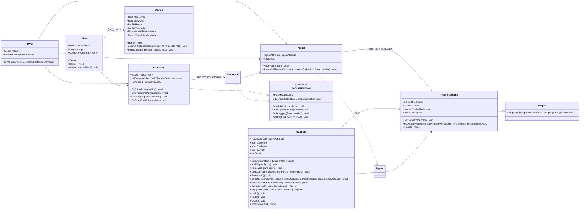

### 作図コマンド

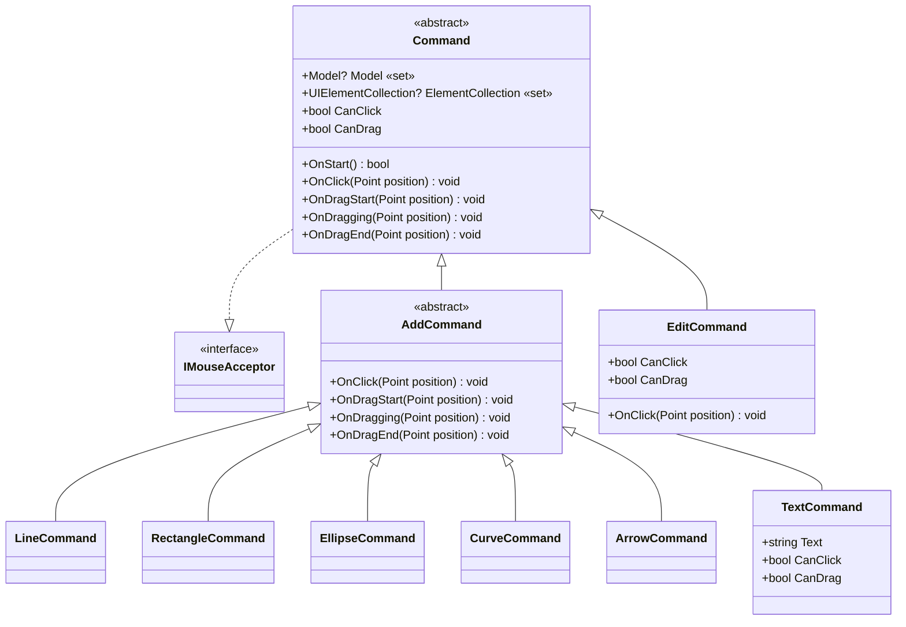

`AddCommand` の派生クラスは、それぞれ同じ名前の図形 (`LineCommand` → `LineFigure` など) を作ります。

### 図形

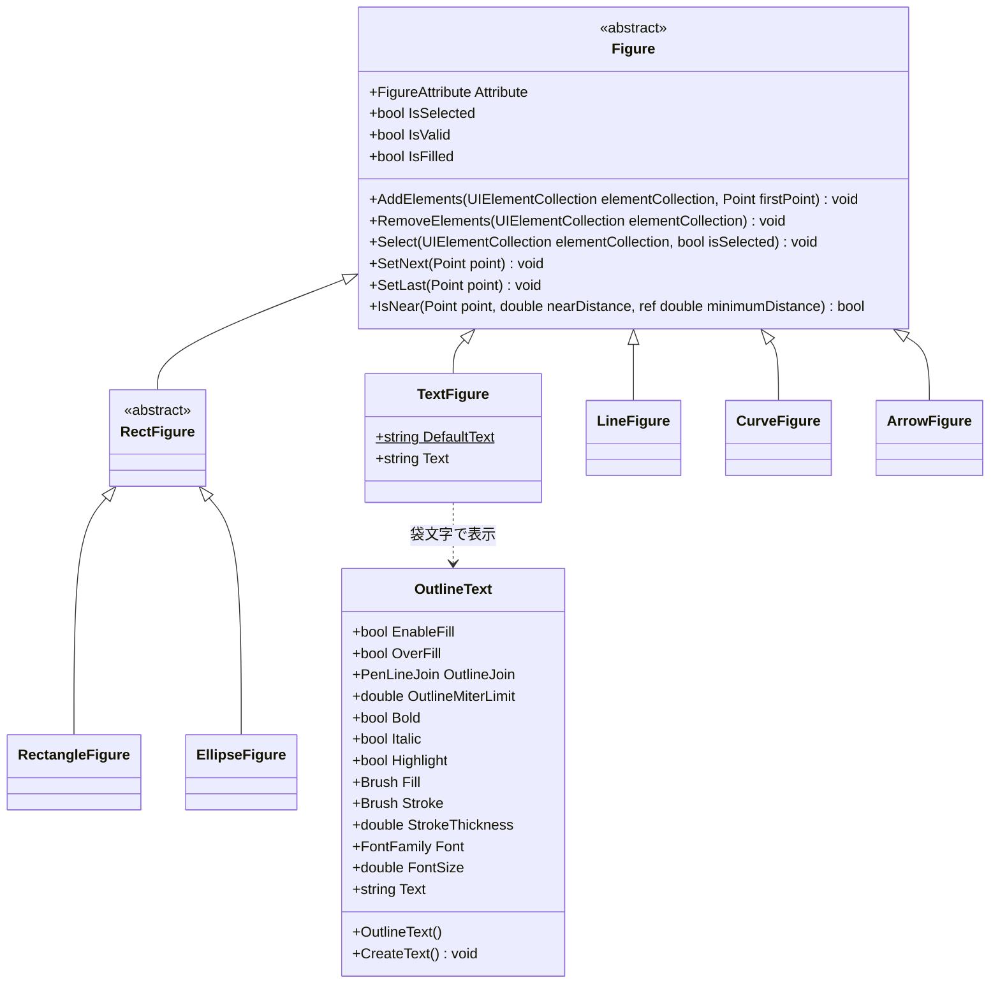

- 各図形は `IsValid` と `IsFilled` を必要に応じてオーバーライドします。
- `OutlineText` (`FrameworkElement` の派生) の各プロパティには、対応する依存関係プロパティ (`TextProperty` などの static フィールド) があります。

### ユーティリティ (幾何計算・ベジエ変換)

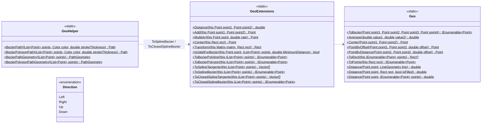

### ユーティリティ (描画・共通)

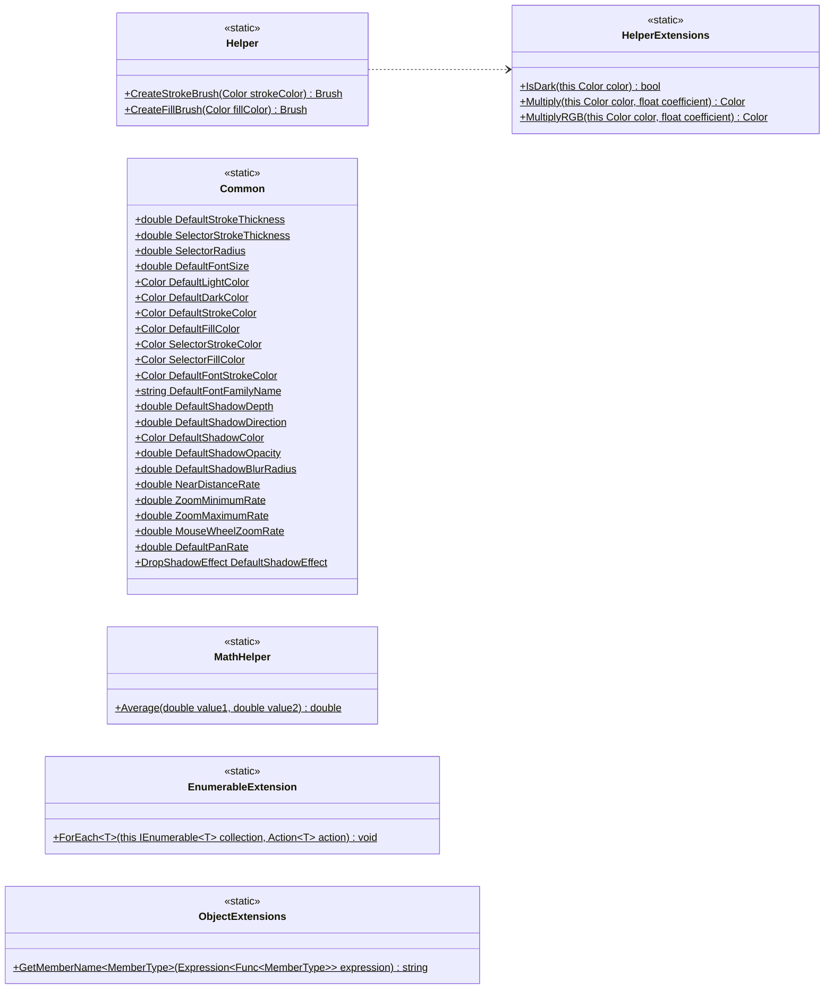

## .NET 版の入力・表示・履歴の仕様

- WPF 両版と CAD は、ボタン解放位置でもドラッグ開始距離を判定します。開始後はその Command が終了まで処理し、途中で選んだ Command は次の操作から使います。
- WinForms 両版は、キャプチャーを失ったときや、解放を取りこぼしてボタンなしの移動を受け取ったときに、最後の有効な位置で曲線を確定します。通常の解放後に喪失通知が来ても二重登録しません。
- CAD のドラッグ開始距離はビュー上の **10 DIP** です。ズームしても画面上の距離は変わらず、Command にはモデル座標を渡します。
- CAD のパン／ズーム後に View をリサイズしても、表示中心のモデル位置を維持します。Home は従来どおりモデル原点を左上とする全体表示へ戻します。Home のままリサイズした場合も左上基準です。
- CAD の表示領域がゼロ寸法の間は最後の有効な行列を保ち、作図・ズーム・パンを停止します。作図中なら最後の有効位置で終了し、正の寸法になれば入力と行列更新を再開します。
- CAD の楕円選択は、WPF の描画と同じく線幅の半分だけ内側に補正した線の中心までの距離を求めます。輪郭を細かい折れ線にし、外接矩形の角では選択しません。線幅より狭い楕円の退化した輪郭も扱います。
- `CadData.Update(olderFigure, newerFigure)` は内部の図形一覧を同じ位置で置き換えます。外部一覧の引数は廃止しました。削除の Undo は元の位置へ戻し、図形の順序も復元します。

## 既知の制限

- **Undo / Redo:** `CadData` に実装はありますが、UI にはつないでいません。つなぐには、操作ごとに `StartCommand()` を呼ぶことと、画面上の要素 (`UIElementCollection`) を同期することが必要です。
- **スクロールバー:** WpfCad2Lib の `View` は `RenderTransform` で拡大するため、拡大しても `ScrollViewer` のスクロールバーは動きません。表示の移動はパンで行います。

ほかの指摘事項と対応状況は、[2026-10-21 のレビュー](Reviews/2026-10-21-repository-review.md) と [2026-10-22 の全体レビュー](Reviews/2026-10-22-repository-review.md) にまとめています。

## ライセンス

[MIT License](LICENSE.txt) © 2023-2026 Fujio Kojima
