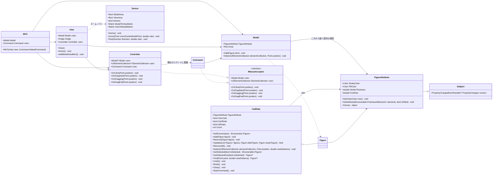
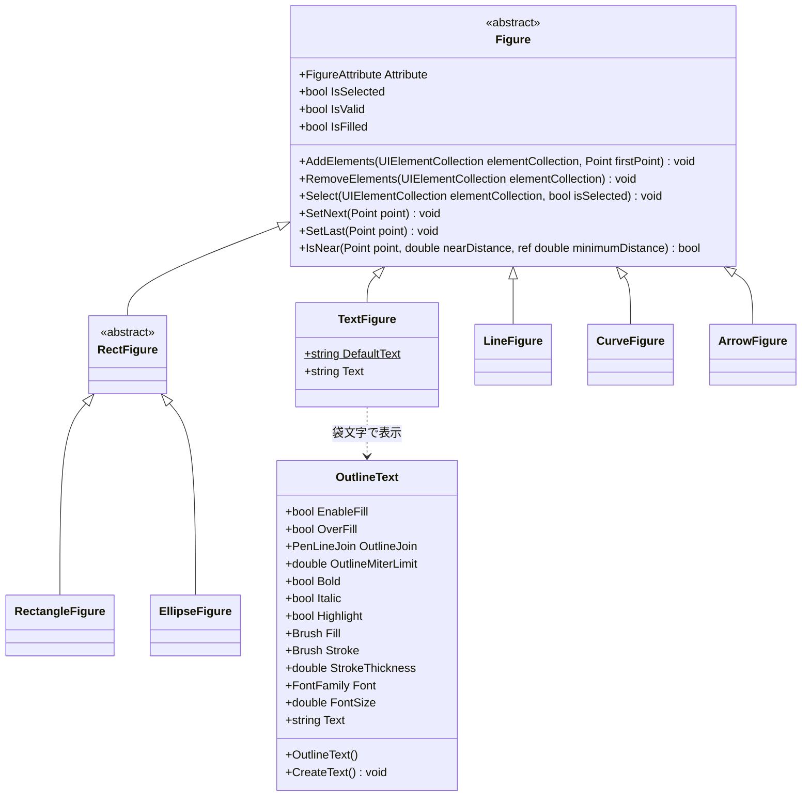
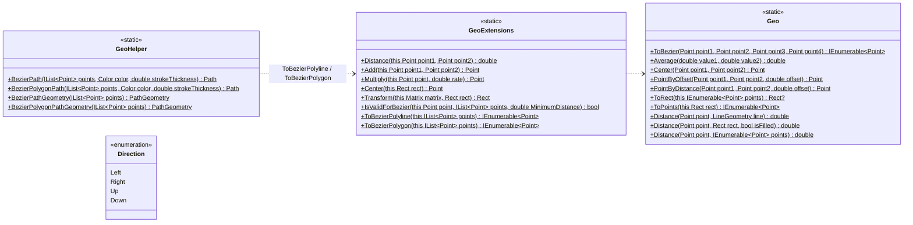
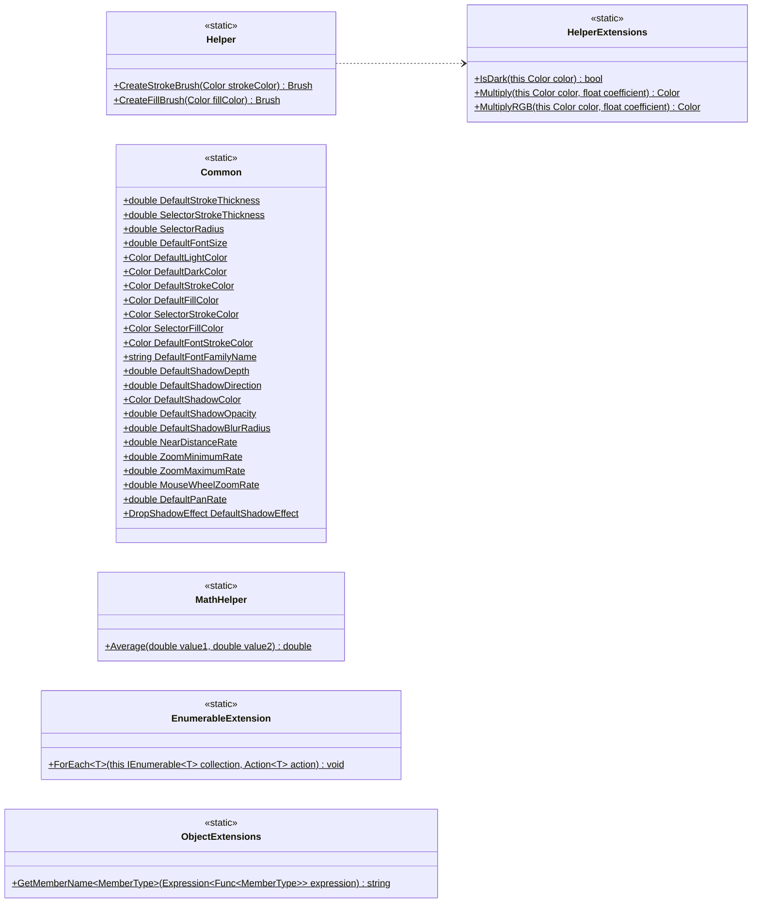

# Shos.BezierSamples

マウスで指定した**通過点を滑らかにつなぐベジエ曲線**を描くサンプル集です。
同じアルゴリズムを Win32 (C++)・Windows Forms・WPF で書き分けているので、API ごとの違いを見比べられます。
WPF 版を発展させた簡易 CAD ライブラリ **WpfCad2Lib** も含まれています。

> 教材として、プロジェクトごとに独立して読めるようにしています。そのため、ベジエ変換のコードや .NET / .NET Framework 版の実装は、意図的にプロジェクトごとに重複させています。

## 目次

- [プロジェクト構成](#プロジェクト構成)
- [動作環境とビルド](#動作環境とビルド)
- [サンプルの操作方法](#サンプルの操作方法)
- [通過点からベジエ曲線を作るしくみ](#通過点からベジエ曲線を作るしくみ)
- [WpfCad2Lib の使い方](#wpfcad2lib-の使い方)
- [WpfCad2Lib のクラス図](#wpfcad2lib-のクラス図)
- [既知の制限](#既知の制限)
- [ライセンス](#ライセンス)

## プロジェクト構成

| プロジェクト | 種類 | ターゲット | 内容 |
|---|---|---|---|
| `BezierWin32` | C++ / Win32 | PlatformToolset v145, C++20 | クリックした点を通るベジエ曲線を描く最小のサンプル |
| `BezierWinForm` | C# / Windows Forms | `net10.0-windows10.0.26100.0` | ドラッグした軌跡をベジエ曲線で描く。Model / View / Controller をデザイナーで配置するコンポーネントとして実装 |
| `BezierWinForm.NETFramework` | C# / Windows Forms | .NET Framework 4.8 | `BezierWinForm` の .NET Framework 版 |
| `BezierWpf` | C# / WPF | `net10.0-windows10.0.26100.0` | 線分・矩形・曲線をメニューで切り替えて描く、コマンド方式のサンプル |
| `BezierWpf.NETFramework` | C# / WPF | .NET Framework 4.8 | `BezierWpf` の .NET Framework 版 |
| `WpfCad2Lib.Core` | C# クラスライブラリ | `net10.0` | UI に依存しない共通部品 (`Subject` など) |
| `WpfCad2Lib.Wpf` | C# / WPF クラスライブラリ | `net10.0-windows10.0.26100.0` | 簡易 CAD ライブラリ。図形・選択・ズーム / パン・袋文字 |
| `WpfCad2Lib.TestApp` | C# / WPF アプリ | `net10.0-windows10.0.26100.0` | WpfCad2Lib の動作確認アプリ |

```text
Shos.BezierSamples.sln
├─ BezierWin32/                  … Win32 (C++)
├─ BezierWinForm/                … Windows Forms (.NET 10)
├─ BezierWinForm.NETFramework/   … Windows Forms (.NET Framework 4.8)
├─ BezierWpf/                    … WPF (.NET 10)
├─ BezierWpf.NETFramework/       … WPF (.NET Framework 4.8)
├─ WpfCad2Lib.Core/              … 共通ライブラリ
├─ WpfCad2Lib.Wpf/               … 簡易 CAD ライブラリ
│   ├─ Core/                     … MVC・コマンド・図形の基底・ズーム / パン
│   ├─ Commands/                 … 作図コマンド
│   ├─ Figures/                  … 図形
│   └─ Utility/                  … ベジエ変換・幾何計算・袋文字など
├─ WpfCad2Lib.TestApp/           … 動作確認アプリ
├─ docs/images/                  … README の図
└─ Reviews/                      … リポジトリのレビュー結果
```

## 動作環境とビルド

すべてのプロジェクトが Windows 専用です。

- Windows 10 / 11
- Visual Studio 2026 (PlatformToolset v145)
  - ワークロード「.NET デスクトップ開発」
  - ワークロード「C++ によるデスクトップ開発」 (`BezierWin32` をビルドする場合)
- .NET 10 SDK
- Windows SDK 10.0.26100
- .NET Framework 4.8 Developer Pack (`*.NETFramework` をビルドする場合)

Visual Studio で `Shos.BezierSamples.sln` を開き、スタートアップ プロジェクトを選んで実行します。
コマンドラインの場合は次のとおりです。

```powershell
# ソリューション全体 (C++ と .NET Framework を含む)。Developer PowerShell で実行する
msbuild Shos.BezierSamples.sln

# .NET 10 版は、プロジェクトごとに dotnet コマンドでビルド・実行できる
dotnet run --project BezierWpf/BezierWpf.csproj
dotnet run --project WpfCad2Lib.TestApp/WpfCad2Lib.TestApp.csproj
```

## サンプルの操作方法

| サンプル | 操作 |
|---|---|
| `BezierWin32` | 左クリックで通過点を追加します。右クリックで全消去します。 |
| `BezierWinForm` | 左ボタンでドラッグすると、その軌跡がベジエ曲線になります。 |
| `BezierWpf` | 「図形」メニューで線分・矩形・曲線を選んでからドラッグします。 |
| `WpfCad2Lib.TestApp` | 下の表を参照してください。 |

`WpfCad2Lib.TestApp` の操作は次のとおりです。

| 操作 | 内容 |
|---|---|
| 「図形」→「選択」 | クリックした位置の近くにある図形を選びます。何もない所をクリックすると選択を解除します。 |
| 「図形」→「線分」「矩形」「楕円」「曲線」「矢印」 | ドラッグで作図します。 |
| 「図形」→「文字列」 | クリックした位置に袋文字を置きます。 |
| 「設定」→「サイズ」「色」 | これから描く図形の線の太さ・文字サイズ・色を変えます。 |
| 「画面」→「ホーム」 | ズームとパンを初期状態に戻します。 |
| マウスホイール | 奥に回すと拡大、手前に回すと縮小します (等倍より小さくはなりません)。 |
| 矢印キー | 表示をパンします。先に作図領域をクリックしてフォーカスを移してください。 |

## 通過点からベジエ曲線を作るしくみ

どのプロジェクトも、**Catmull-Rom スプライン**と同じ考え方で、通過点の列から 3 次ベジエ曲線の制御点を求めています。

### 1 区間の制御点

隣り合う通過点 P1 → P2 の区間を描くとき、その両隣の点 P0 と P3 も使います。


- P1 での曲線の向きは、両隣を結ぶ弦 **P0 → P2** と平行にします。
- P2 での曲線の向きは、両隣を結ぶ弦 **P1 → P3** と平行にします。
- 制御点は、それぞれの弦の **1/6** だけ通過点から離れた位置に置きます。

```text
C1 = P1 + (P2 − P0) / 6
C2 = P2 − (P3 − P1) / 6
```

1/6 という値は、次の 2 つを組み合わせたものです。

- Catmull-Rom スプラインでは、点 P1 での接線を `(P2 − P0) / 2` とします。
- 3 次ベジエ曲線では、端点から接線の 1/3 だけ離れた位置に制御点を置きます。

この 2 つを掛けて `1/2 × 1/3 = 1/6` になります。
こうすると、隣の区間と通過点で向きがそろうので、つなぎ目が滑らかになります。

### 点列全体

n 個の通過点 P0〜P(n−1) では、前後に点がそろっている内側の n − 3 区間をベジエ曲線で描きます。
最初の区間 (P0 → P1) と最後の区間は、片側の点が無くて向きが決まらないので、直線で描きます。


変換処理は、`[始点, 制御点1, 制御点2, 終点, 制御点1, 制御点2, 終点, …]` の形の点列を返します。
各 API のベジエ描画関数が受け取る形式と同じです。
WpfCad2Lib の実装 (`GeoExtensions.ToBezierPolyline`) は次のとおりです (コメントは説明のために足したものです)。

```csharp
// C# 14 の拡張メンバー。points.ToBezierPolyline() の形で呼べる
extension(IList<Point> points)
{
    public IEnumerable<Point> ToBezierPolyline()
    {
        if (points.Count < 4) {
            foreach (var point in points)
                yield return point;
        } else {
            const double a = 1.0 / 6.0;
            yield return points[1];
            for (var index = 0; index < points.Count - 3; index++) {
                yield return points[index + 1] + Vector.Multiply(points[index + 2] - points[index + 0], a); // C1
                yield return points[index + 2] + Vector.Multiply(points[index + 1] - points[index + 3], a); // C2
                yield return points[index + 2];                                                            // 終点
            }
        }
    }
}
```

- **閉じた曲線:** `ToBezierPolygon` は、点列の末尾に先頭の 3 点を付け足してから同じ変換をします。こうすると、すべての区間がベジエ曲線になって 1 周つながります。
- **点の間引き:** ドラッグで点を集めるサンプルでは、マウスの細かい揺れで曲線が波打たないよう、直前の点から一定距離以上動いたときだけ点を追加します。距離は `BezierWinForm` が 10、`BezierWpf` が 16、WpfCad2Lib の `CurveFigure` が 8 です。ドラッグを終えた位置は、距離にかかわらず必ず曲線の終点になります。

プロジェクトごとの描画 API は次のとおりです。

| プロジェクト | 変換 | 描画 |
|---|---|---|
| `BezierWin32` | `Win32Graphics::ToBezierPolyline` | `::Polyline` + `::PolyBezierTo` |
| `BezierWinForm` | `GeometryExtensions.ToBezierPolyline` | `Graphics.DrawLine` + `Graphics.DrawBeziers` |
| `BezierWpf` | `GeometryExtensions.ToBezierPolyline` | `PathGeometry` + `LineSegment` / `BezierSegment` |
| `WpfCad2Lib.Wpf` | `GeoExtensions.ToBezierPolyline` | `GeoHelper.BezierPathGeometry` (`PathGeometry`) |

## WpfCad2Lib の使い方

`View` (UserControl) をウィンドウに置き、`MVC` で Model・View・Controller を結び付けます。
描画モードは `mvc.Command` に作図コマンドを設定して切り替えます。

```xml
<Window x:Class="MyApp.MainWindow"
        xmlns="http://schemas.microsoft.com/winfx/2006/xaml/presentation"
        xmlns:x="http://schemas.microsoft.com/winfx/2006/xaml"
        xmlns:w="clr-namespace:WpfCad2Lib.Wpf;assembly=WpfCad2Lib.Wpf">
    <w:View x:Name="view" />
</Window>
```

```csharp
using System.Windows;
using System.Windows.Media;
using WpfCad2Lib.Wpf;

public partial class MainWindow : Window
{
    readonly MVC mvc;

    public MainWindow()
    {
        InitializeComponent();
        mvc = new MVC(view, new EditCommand());                  // 最初は選択モード
        mvc.Model.Area = new Rect(new Size(1000.0, 1000.0));     // 作図領域 (モデル座標)
    }

    void OnCurve(object sender, RoutedEventArgs e) => mvc.Command = new CurveCommand();
    void OnText (object sender, RoutedEventArgs e) => mvc.Command = new TextCommand { Text = "ラベル" };
    void OnBlue (object sender, RoutedEventArgs e) => mvc.Model.FigureAttribute.SetColor(Colors.Blue);
    void OnHome (object sender, RoutedEventArgs e) => view.Home();
}
```

- `Model.FigureAttribute` (色・線の太さ・文字サイズ) は、**これから描く図形**に複製して使われます。描き終えた図形には影響しません。
- 背景に画像を表示するには、`view.Image.Source` に画像を設定します。`WpfCad2Lib.TestApp` の `MainWindow.xaml.cs` を参照してください。
- 独自の図形を追加するには、次の 2 つを作ります。
  - `Figure` の派生クラス。protected の `Bounds`・`GetInitialElements`・`SetFirst` を実装し、必要なら `SetNext` / `SetLast` もオーバーライドします。
  - その図形を返す `AddCommand` の派生クラス。`CreateFigure` をオーバーライドします。

## WpfCad2Lib のクラス図

利用者向けに、**public な型とメンバーだけ**を載せています (継承用の protected メンバーと private メンバーは省略)。
表記は次のとおりです。

- `«set»`: 書き込み専用のプロパティ
- `$`: static メンバー
- `*`: 抽象メンバー

型はすべて名前空間 `WpfCad2Lib.Wpf` にあります。ただし `Subject`・`MathHelper`・`EnumerableExtension`・`ObjectExtensions` は `WpfCad2Lib.Core` です。

### MVC の構成



### 作図コマンド

```mermaid
classDiagram
    direction TB

    class IMouseAcceptor {
        <<interface>>
    }
    class Command {
        <<abstract>>
        +Model? Model «set»
        +UIElementCollection? ElementCollection «set»
        +bool CanClick
        +bool CanDrag
        +OnStart() bool
        +OnClick(Point position) void
        +OnDragStart(Point position) void
        +OnDragging(Point position) void
        +OnDragEnd(Point position) void
    }
    class AddCommand {
        <<abstract>>
        +OnClick(Point position) void
        +OnDragStart(Point position) void
        +OnDragging(Point position) void
        +OnDragEnd(Point position) void
    }
    class EditCommand {
        +bool CanClick
        +bool CanDrag
        +OnClick(Point position) void
    }
    class TextCommand {
        +string Text
        +bool CanClick
        +bool CanDrag
    }
    class LineCommand
    class RectangleCommand
    class EllipseCommand
    class CurveCommand
    class ArrowCommand

    Command ..|> IMouseAcceptor
    Command <|-- EditCommand
    Command <|-- AddCommand
    AddCommand <|-- LineCommand
    AddCommand <|-- RectangleCommand
    AddCommand <|-- EllipseCommand
    AddCommand <|-- CurveCommand
    AddCommand <|-- ArrowCommand
    AddCommand <|-- TextCommand
```



`AddCommand` の派生クラスは、それぞれ同じ名前の図形 (`LineCommand` → `LineFigure` など) を作ります。

### 図形



- 各図形は `IsValid` と `IsFilled` を必要に応じてオーバーライドします。
- `OutlineText` (`FrameworkElement` の派生) の各プロパティには、対応する依存関係プロパティ (`TextProperty` などの static フィールド) があります。

### ユーティリティ (幾何計算・ベジエ変換)



### ユーティリティ (描画・共通)



## 既知の制限

- **Undo / Redo:** `CadData` に実装はありますが、UI にはつないでいません。つなぐには、操作ごとに `StartCommand()` を呼ぶことと、画面上の要素 (`UIElementCollection`) を同期することが必要です。
- **スクロールバー:** WpfCad2Lib の `View` は `RenderTransform` で拡大するため、拡大しても `ScrollViewer` のスクロールバーは動きません。表示の移動はパンで行います。
- **両端の区間:** 曲線の最初と最後の区間は直線になります。理由は [点列全体](#点列全体) を参照してください。

ほかの指摘事項と対応状況は、[Reviews/2026-10-21-repository-review.md](Reviews/2026-10-21-repository-review.md) にまとめています。

## ライセンス

[MIT License](LICENSE.txt) © 2023-2026 Fujio Kojima
